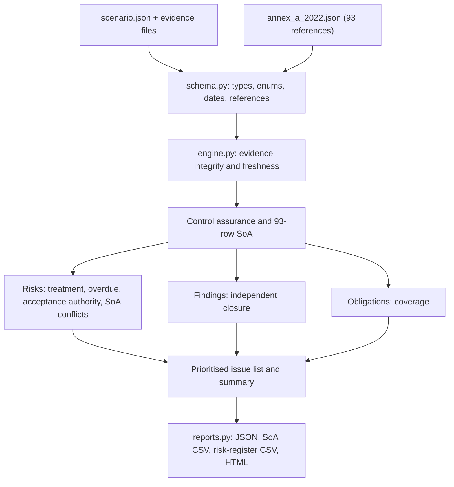

# Architecture and engineering decisions

Python standard library was selected for reproducible offline use and low setup cost. Validation is separate from assessment so that malformed input fails with a clear `Scenario error` (exit code 2) instead of a traceback or, worse, a misleading report. The test suite regenerates the committed reports and compares them byte-for-byte, and `.gitattributes` keeps line endings identical on Windows and Linux. Structured JSON makes assumptions inspectable in Git. Reports are derived outputs, never the source of truth. Dates are evaluated against an explicit assessment date. SHA-256 identifies changed evidence bytes; it is not a signature or provenance guarantee.

## Data relationships
Asset → risk → selected controls (must be included in the SoA) → evidence. Obligations → controls. Findings link one risk and one control plus closure evidence. Every control must be an Annex A identifier or be marked `additional`. Duplicate identifiers, wrong types, invalid dates and broken references are rejected. A future database should enforce the same relationships transactionally.

## Technical adapter
The device check reads an explicitly synthetic Microsoft Graph-shaped JSON file. Missing, invalid or negative quota gives `unknown`; zero means no permitted registrations and passes the maximum-only check, but needs usability review. A result remains a technical observation; it cannot automatically mark an ISO control effective. The release does not directly integrate with AutoAudit or Graph.

## Release limits
Reviewers and owners are labels, not authenticated identities. Evidence quality and relevance require manual judgment. The engine cannot tell whether a document truthfully describes an effective control. There is no live connector, database, multi-user API, signed audit log, production RBAC, full standard coverage or deployed web application. Reports are static local HTML. Inputs are trusted local project files; they are validated, but a hostile file could still exhaust memory.

## Production gates
Before real organizational data: threat model; authenticated roles and separation of duties; migrations and transactional storage; evidence ACLs and retention; signed/versioned provenance; tenant isolation; secure upload limits and malware handling; backup/restore testing; security review; operational monitoring and incident response. A checksum-only registry must never be represented as immutable audit storage.
